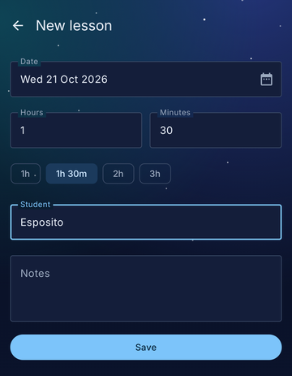
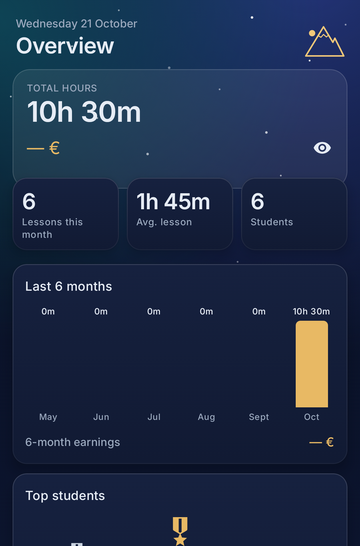
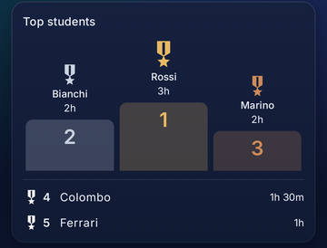
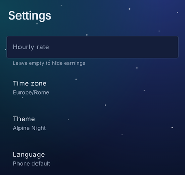

<p align="center">
  
</p>

<h1 align="center">MasterSki</h1>

<p align="center">
  <b>Keep track of every ski lesson you teach — hours, students and pay, right on your phone.</b>
</p>

<p align="center">
  <a href="https://github.com/RexSAS/MasterSki/releases/latest"></a>
  
  
  
</p>

---

Ski instructors are paid by the hour, and at the end of the month the hours have to add up. **MasterSki** is a small, fast app to log each lesson the moment it ends and check your monthly hours against what the ski school pays you.

<p align="center">
  
  &nbsp;
  
  &nbsp;
  
  &nbsp;
  
</p>

## Features

- **Log a lesson in seconds** — date, duration (quick buttons for 1h, 1h 30m, 2h, 3h), student name with suggestions from previous lessons, and optional notes. Group lessons? Just write it in the name, e.g. *Group Rossi*.
- **Monthly and lifetime hours** — the Overview shows your total hours and a row for every month; tap a month to see its lessons. On *Lessons*, each month is grouped with its total.
- **Private earnings** — set your hourly rate and MasterSki calculates what you earned. Amounts stay hidden as `**** €` until you tap the eye, and hide again when you leave the screen.
- **Statistics with charts** — under your totals, the Overview shows lessons this month, average lesson length, your number of students, a 6-month hours chart, a podium of your top students and your busiest weekdays. Any money there stays hidden until you tap the eye.
- **Alpine Night theme** — a starry night sky over snow-lit mountains, deep-navy tiles and gold accents, with an animated splash screen. On by default; prefer a plain look? Pick *Classic* in Settings.
- **Swipe between pages** — swipe left and right to move between Lessons, Overview and Settings.
- **Italiano / English** — the app follows your phone's language, or pick one in Settings.
- **Edit or undo** — tap a lesson to fix it, or swipe it away and confirm to delete. Changed your mind? Tap *Undo*.
- **Automatic updates** — when a new version is out, MasterSki offers it when you open the app, backs up your lessons first and installs it with Android's installer.
- **Backups and restore** — up to 3 backups are kept inside the app (one before every update, or any time with *Back up now*). Restore one from *Settings → Backups*, behind two confirmation steps.
- **Export to CSV** — save all your lessons as a spreadsheet to keep a backup or send to the ski school.
- **Your time zone** — "today" follows the time zone you pick (default *Europe/Rome*).
- **Private** — no account, no tracking. The internet is used only to check GitHub for updates; your lessons never leave your phone.

## Install

1. On your Android phone, open the [latest release](https://github.com/RexSAS/MasterSki/releases/latest) and download **`MasterSki-x.y.apk`**.
2. Open the file and allow *Install unknown apps* when Android asks. From 1.2 on, MasterSki updates itself: it asks once to be allowed to install apps.
3. Open **MasterSki**, set your hourly rate in *Settings*, and log your first lesson with **+**.

Already on 1.0 or 1.1? Install the new APK over it once: your lessons and settings are kept. See the [changelog](CHANGELOG.md) for what's new.

> [!WARNING]
> Uninstalling the app deletes all lessons. Use **Settings → Export to CSV** regularly as a backup — the CSV is a copy for your records and cannot be imported back.

## Build from source

Requirements: JDK 17 and the Android SDK (platform 35, build-tools 35.0.0).

```sh
export JAVA_HOME=$HOME/.local/jdk17
export ANDROID_HOME=$HOME/Android/Sdk
export PATH=$JAVA_HOME/bin:$ANDROID_HOME/platform-tools:$PATH

./gradlew testDebugUnitTest   # run the tests
./gradlew installDebug        # install a debug build on a connected phone
./gradlew assembleRelease     # build app/build/outputs/apk/release/app-release.apk
```

### Release signing

Create a keystore once:

```sh
keytool -genkeypair -v -keystore ~/masterski-release.jks -alias masterski -keyalg RSA -keysize 2048 -validity 10000
```

Then add `keystore.properties` in the repository root:

```properties
storeFile=~/masterski-release.jks
storePassword=...
keyAlias=masterski
keyPassword=...
```

Without this file `assembleRelease` produces an unsigned APK that cannot be installed.

> [!CAUTION]
> Back up the keystore and its password. If you lose them, updates can no longer be installed over the existing app. Never commit the keystore or `keystore.properties` (both are git-ignored).

A debug build is signed differently from the release build: uninstall it (export your lessons first!) before installing the release.

### Publishing a release

The in-app updater reads `https://api.github.com/repos/RexSAS/MasterSki/releases/latest`, so every release must:

- use a tag like `v1.3.0` (a higher number than the installed version);
- have exactly one `.apk` asset;
- be signed with the same keystore (Android refuses updates signed with another key);
- bump `versionCode` and `versionName` in `app/build.gradle.kts`.

To test the update flow before publishing, build a private APK that thinks it is older: `./gradlew assembleRelease -PversionNameOverride=1.0.9`.

## Tech

Kotlin · Jetpack Compose (Material 3) · Room · DataStore · Navigation Compose · AppCompat per-app languages · MVVM · JUnit + Robolectric
