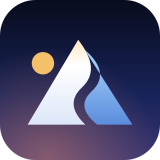
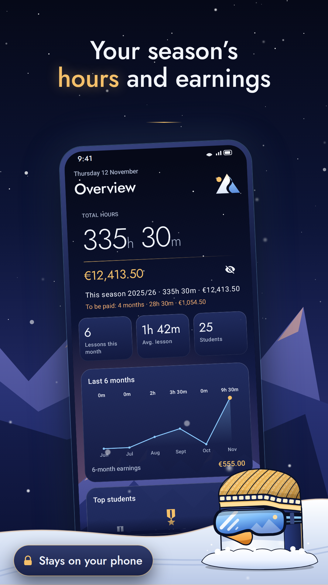
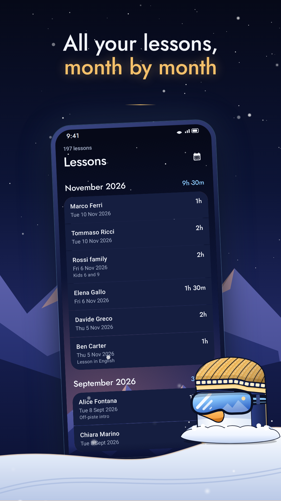
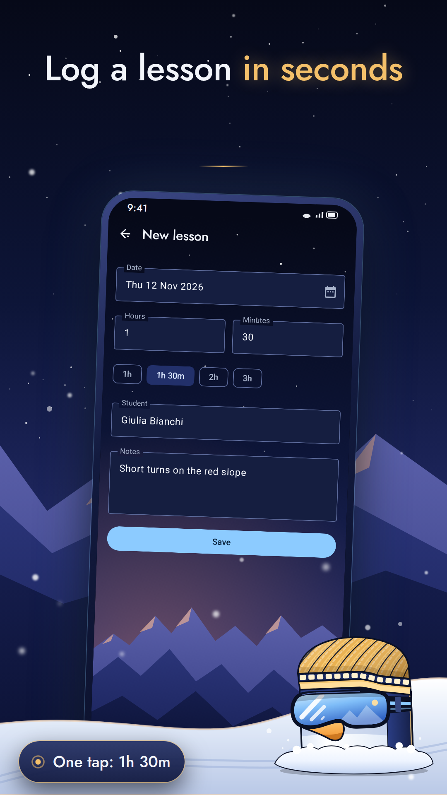
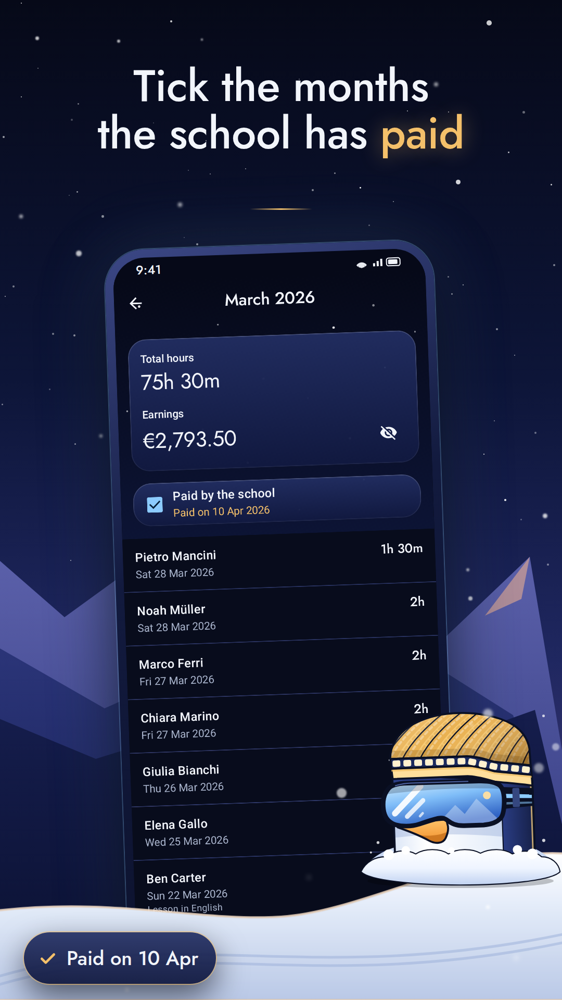

<p align="center">
  
</p>

<h1 align="center">Karvo</h1>

<p align="center">
  <b>The lesson log for ski instructors.</b><br>
  Log every lesson in seconds and always know your hours, your students and what you're owed.
</p>

<p align="center">
  <a href="https://github.com/RexSAS/Karvo/releases/latest"></a>
  <a href="https://play.google.com/store/apps/details?id=com.karvo"></a>
  <a href="https://karvo.rxsas.it"></a>
  
  
  
</p>

<p align="center">
  
  &nbsp;
  
  &nbsp;
  
  &nbsp;
  
</p>

---

Ski instructors are paid by the hour, and at the end of the month the hours have to add up. **Karvo** lets you log each lesson the moment it ends, then see your month, your season and your pay at a glance. No account, no sign-up, nothing to set up. Everything is free: no Pro plan, no ads, no in-app purchases.

## Features

### ⛷️ Log a lesson in seconds
- Quick durations (1h, 1h 30m, 2h, 3h) or type your own, with student names suggested from your past lessons.
- A note for each lesson, like "Kids 6 and 9" or "Lesson in English".
- Lessons grouped by month with each month's total.
- **Search** by student or note, and filter to the lessons not paid yet.

### 💶 Your hours and your pay
- **Overview** opens on this season, compared with last season at the same date. The season picker switches to any past season or to **Lifetime**.
- Earnings from your hourly rate, hidden until you tap the eye, with fingerprint, face or PIN if you want.
- Tick the months the school has paid and always see what is still to be paid.
- Statistics: lessons this month, average lesson, students, the last 6 months, your busiest weekdays and a podium of your top students.
- **Student page**: tap a student for their hours, lessons, months, seasons and earnings.

### 🏅 Season badges
- 14 badges unlock as your season's hours grow, from **Karver** at your first hour to **Legend of the slopes** at 600h, in bronze, silver, gold, amethyst and ice.
- Each new badge arrives with a notification and an unlock animation. The badge page shows your progress to the next one and your best badge of every season.

### 📱 Home-screen widgets
- **This week** and **This month**: your hours and lessons, with a **+** to add a lesson.
- **Overview**: the week big, plus the month, today, the season and your next event.
- **This week vs last**: both weeks' hours, day by day, as two curves.

### 📅 Calendar and reminders
- Add events to any day, like "Ski school meeting 17:00". Karvo reminds you at 07:30 that day.
- The next 3 days' events sit right on the Lessons page.
- On the season's first day Kevin wishes you a good one, and Karvo sums up last season and its unpaid months.

### 📷 Moments
- Tap for a photo, hold for a video of up to 10 seconds: up to 3 moments a day.
- Your season as a photo calendar: tap a day for its moments, lessons and hours.
- Share in a Karvo design (Photobomb, Frame or Banner) or straight to an Instagram story.
- Everything is saved to a *Karvo* album in your gallery, and *Restore moments* brings it back after a new phone.

### 💻 On your PC and iPhone too
Open **[karvo.rxsas.it](https://karvo.rxsas.it)** on your computer or iPhone and link it by scanning a code. While Karvo is open on your phone, it shows your lessons, calendar, statistics and badges on the big screen, and every change you make there is saved on your phone. Phone and PC talk end-to-end encrypted.

### 🛟 Safe and helpful
- Up to 3 backups inside the app, plus CSV export and import (MasterSki files too).
- **Report a problem** from Settings: you can follow the answers under *My reports* and reply to them.
- A **quick tour** on the first start (replay it from Settings), and *What's new* after each update.
- The *First Light* look, with the night sky over the mountains and Kevin the penguin, or the plainer *Classic* theme.
- In Italian and English: Karvo follows your phone's language, or you can pick one in Settings.

## Privacy

Karvo has no accounts, no analytics and no ads, and keeps no copy of your lessons on any server: they live only on your phone. Photos and videos go to your phone's gallery. Fingerprint unlock is handled by Android: Karvo never sees your fingerprint.

Karvo uses the internet for just two things, and only when you choose them:
- **Linking a PC**: the data travels end-to-end encrypted through a relay (`link.rxsas.it`) that can't read it and stores none of it.
- **Report a problem**: your report becomes a public issue on this repository. No lessons are sent.

If your phone's Google backup is on, Android includes Karvo's data in it, so your lessons come back on a new phone. The full details are in the [privacy policy](PRIVACY.md).

## Roadmap

### Shipped
- [x] **Moments**, calendar, full-screen viewer and sharing (3.0)
- [x] **PC link** via karvo.rxsas.it, end-to-end encrypted (3.1)
- [x] **Calendar events** with a 07:30 reminder (3.2)
- [x] **New look "First Light"**, new logo and **Kevin** the penguin (3.3)
- [x] **Photobomb** sharing (3.4)
- [x] **Season picker**, **student page**, swipe back and the **season start** greeting (3.5)
- [x] **Season badges** and **home-screen widgets** (3.6)
- [x] **Search and filters**, **Report a problem** with My reports and replies, **animated badges** and a longer **quick tour** (3.7)

### Ideas
- [ ] **Repeat a lesson**: long-press a lesson to log the same student and duration again.
- [ ] **Evening reminder**: an optional notification on days with nothing logged.
- [ ] **Goals**: set a season target and follow your progress on Overview.
- [ ] **Season Wrapped**: your season in one shareable card.

See the [changelog](CHANGELOG.md) for what's new in each version.

## Download

Karvo is on **[Google Play](https://play.google.com/store/apps/details?id=com.karvo)**, in a closed test for now: the page opens once you've joined the test as a tester. Everyone else can install the APK from the [latest GitHub release](https://github.com/RexSAS/Karvo/releases/latest): download **`Karvo-x.y.apk`**, open it and allow *Install unknown apps* when Android asks. The GitHub version updates itself from inside the app.

On a PC or an iPhone, open **[karvo.rxsas.it](https://karvo.rxsas.it)** and link it to the app on your phone.

<details>
<summary><b>For developers</b></summary>

Requirements: JDK 17 and the Android SDK (platform 36).

```sh
./gradlew testGithubDebugUnitTest   # run the tests
./gradlew assembleGithubRelease     # APK for GitHub releases (with the in-app updater)
./gradlew bundlePlayRelease         # AAB for Google Play (no updater)
```

Release builds are signed with the key in `keystore.properties` (git-ignored). Every release bumps `versionCode` and `versionName`, is tagged `vX.Y.Z` and has exactly one `Karvo-X.Y.apk` asset, which the in-app updater downloads.

Kotlin · Jetpack Compose (Material 3) · Room · DataStore · Navigation Compose · App widgets · JUnit + Robolectric

</details>
